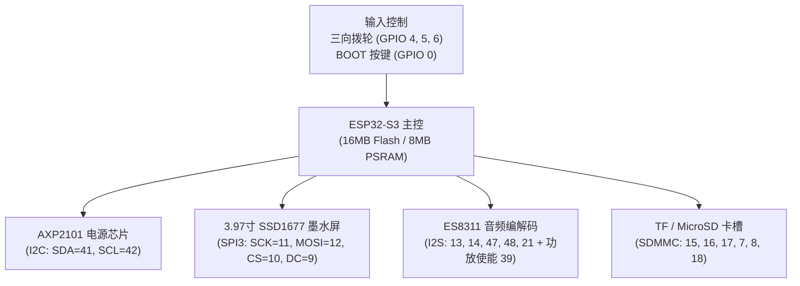
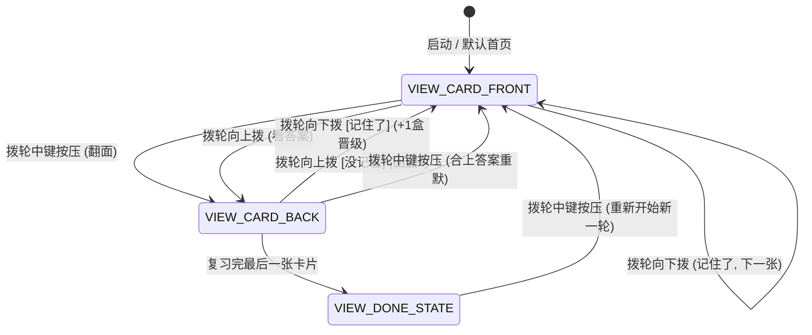
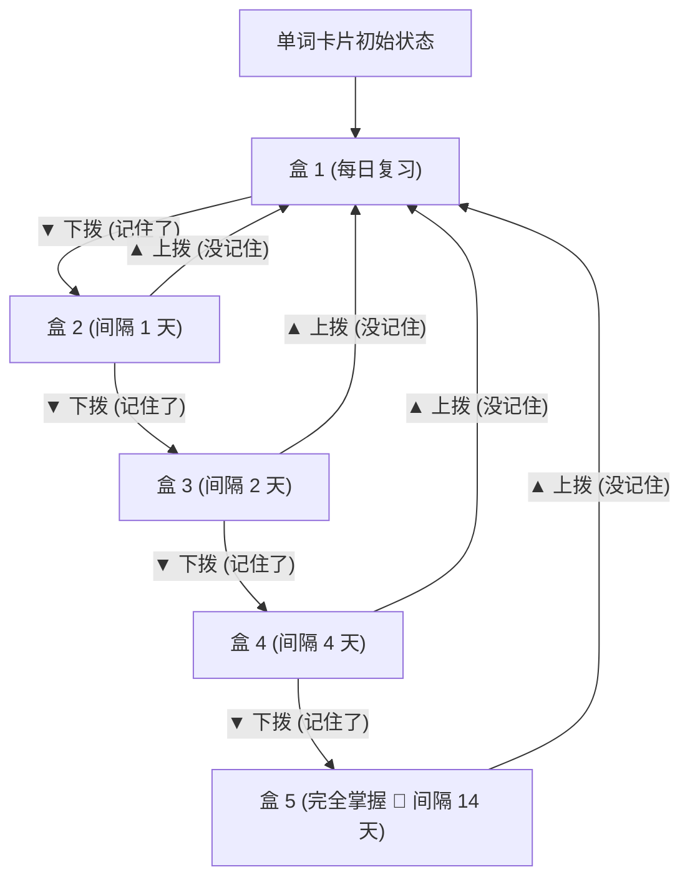
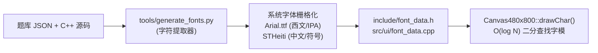

# ESP32-S3 3.97寸墨水屏 SPBCN 单词卡完整产品手册与工程文档

> **项目名称**：SPBCN 单词背诵卡 (E-Paper Flashcard Device)  
> **目标硬件**：微雪 Waveshare ESP32-S3-ePaper-3.97 开发板  
> **显示规格**：3.97 英寸 800×480 黑白电子墨水屏 (SSD1677，480×800 竖屏拟物卡片排版)  
> **固件框架**：PlatformIO + Arduino-ESP32 (16MB Flash, 8MB PSRAM)  

---

## 一、 产品概述与设计理念

本项目将 **SPBCN 拼字大会**核心词库移植至低功耗电子墨水屏终端，打造一款专注于沉浸式词汇记忆的便携手持硬件。

* **极致护眼与阅读质感**：基于 3.97 英寸 300 DPI 电子纸屏幕，采用黑白高对比度拟物索引卡片（Index Card）视觉设计，带来如纸质抽认卡般的沉浸式阅读体验。
* **单手盲操与流线交互**：针对手持拇指工效学，通过三向滚轮拨轮与轻触按键，实现单手“翻面”、“评定”、“切卡”全流程盲操。
* **科学间隔复习系统 (SRS)**：深度集成 **Leitner 5 盒艾宾浩斯记忆模型**，根据复习反馈动态晋升与惩罚降级卡片，形成高效学习闭环。
* **双显存无闪烁局部刷新**：充分发挥 SSD1677 双 RAM 差分更新特性，日常操作实现 0.3 秒无闪烁极速切帧，兼顾长效防残影机制。

---

## 二、 硬件架构与外设引脚配置

硬件平台基于 ESP32-S3 (双核 240MHz)，板载 16MB Flash 与 8MB OPI PSRAM。所有外设引脚经过逆向与官方 BSP 双重验证：



### 1. 详细引脚定义表

| 外设模块 | 引脚名称 | ESP32-S3 GPIO | 信号属性 / 配置模式 | 作用与功能说明 |
| :--- | :--- | :--- | :--- | :--- |
| **墨水屏 (EPD)** | `EPD_SCK` | GPIO 11 | SPI3 SCLK (20MHz) | 墨水屏 SPI 时钟线 |
| | `EPD_MOSI` | GPIO 12 | SPI3 MOSI | 墨水屏 SPI 数据线 |
| | `EPD_CS` | GPIO 10 | Output (Active LOW) | 墨水屏片选引脚 |
| | `EPD_DC` | GPIO 9 | Output (LOW=Cmd, HIGH=Data) | 数据 / 命令切换引脚 |
| | `EPD_RST` | GPIO 46 | Output (Active LOW) | 硬件复位引脚 |
| | `EPD_BUSY` | GPIO 3 | Input (HIGH=Busy, LOW=Idle) | 状态忙引脚 (带超时保护) |
| **三向拨轮 (Dial)** | `DIAL_UP` | GPIO 4 | Input Pull-up (Active LOW) | 向上拨动 (正面看答案 / 背面没记住) |
| | `DIAL_CONFIRM` | GPIO 5 | Input Pull-up (Active LOW) | 中键垂直按压 (翻面 / 确认) |
| | `DIAL_DOWN` | GPIO 6 | Input Pull-up (Active LOW) | 向下拨动 (记住了, 正反面都可) |
| **侧边按键** | `BTN_BOOT` | GPIO 0 | Input Pull-up (Active LOW) | 单击发音 / 长按 1.2s 全刷 |
| | `BTN_PWR` | GPIO 1 | Power Input | 电源开关管理键 |
| **I2C 总线** | `I2C_SDA` | GPIO 41 | Open-Drain Pull-up (400kHz) | AXP2101 / ES8311 数据线 |
| | `I2C_SCL` | GPIO 42 | Open-Drain Pull-up (400kHz) | AXP2101 / ES8311 时钟线 |
| **I2S 音频** | `I2S_MCLK` | GPIO 13 | Output | ES8311 主时钟 |
| | `I2S_BCLK` | GPIO 14 | Output | 位时钟 |
| | `I2S_WS` | GPIO 47 | Output | 声道选择时钟 (LRCK) |
| | `I2S_DOUT` | GPIO 48 | Output | DAC 喇叭音频数据输出 |
| | `AUDIO_PA_CTRL`| GPIO 39 | Output (HIGH=Enable) | 板载音频功放使能开关 |
| **TF 存储卡** | `SD_CLK/CMD/D0~D3`| 16, 17, 15, 7, 8, 18 | SDMMC 4-bit 接口 | 词库与 412 个真人 MP3 存放 |

---

## 三、 用户交互指南 (Interaction Guide)

设备专为**正向手持、单手拇指盲操**设计，交互状态机覆盖“正面回忆”、“背面评定”与“结算完成”三大核心场景：



### 1. 场景交互操作速查表

| 操作手势 | 处于卡片正面 (回忆模式) | 处于卡片背面 (揭晓答案与评定) | 今日复习完成页 (结算统计) |
| :--- | :--- | :--- | :--- |
| **拨轮中键按压 ◉** | **翻面**（进入背面查看中文释义与例句） | **翻回正面**（合上答案重新默记） | **重新开始**（从第 1 张开启新复习） |
| **拨轮向下拨动 ▼** | **记住了！**（会的词不用翻面，晋升 +1 盒，切下一张） | **记住了！**（晋升 +1 盒，切下一张） | **重新开始** |
| **拨轮向上拨动 ▲** | **翻面看答案**（同中键） | **没记住！**（惩罚回 盒 1，切下一张） | **重新开始** |
| **短按 BOOT 键 ●** | **播放发音**（真人朗读当前单词） | **重播发音** | 无动作 |
| **长按 BOOT 键 (1.2s)** | **强制全局全刷**（消除残影） | **强制全局全刷**（消除残影） | **强制全局全刷**（消除残影） |

---

## 四、 极简拟物卡片 UI 规范

界面统一在 **480×800 竖屏逻辑坐标系**下进行像素级渲染，整体划分为四大视觉区块：

```
+-----------------------------------------------------------+ 0
| [ SPBCN R1 ]        第 1 / 10 张  ■■□□□         100% [=]   | 14~42 (顶部状态栏)
+-----------------------------------------------------------+ 44 (细分割线)
| +-------------------------------------------------------+ | 54
| |  # plain                             ★ Leitner 盒 1   | | 70~102 (卡片内头部)
| | - - - - - - - - - - - - - - - - - - - - - - - - - - - | | 106 (浅点虚线)
| |                                                       | |
| |                         work                          | | 230 (48px 粗黑体)
| |                                                       | |
| |                       /wɜ:rk/                         | | 305 (24px 音标)
| |                                                       | |
| |                   [ 🔊 BOOT 发音 ]                    | | 368~400 (发音胶囊)
| |                                                       | |
| | - - - - - - - - - - - - - - - - - - - - - - - - - - - | | 480 (装饰虚线)
| |                                                       | |
| |               [ ◉ 按中键 · 看释义 ]                  | | 550~606 (黑底白字按键)
| |                                                       | |
| +-------------------------------------------------------+ | 704 (双线拟物外框)
|                                                           |
|             ▲ 看答案              ▼ 记住了                 | 734 (操作提示)
|                长按 BOOT 键消除墨水屏残影                  | 760 (底部署名)
+-----------------------------------------------------------+ 800
```

### 1. 顶部全局状态栏 (y = 12 .. 44)
* **词库胶囊徽章**：左侧圆角矩形包裹 `[ SPBCN R1 ]`，字体 16px。
* **卡片计数与微型 5 盒分段柱**：居中展示 `1 / 10`，紧随 5 颗分段微型进度柱（宽 12px，高 7px）。已掌握盒子实心黑底，未达到线框白底，直观呈现掌握阶段。
* **实时电量计**：动态绘制 22×12px 电池外壳与电量比例填充块，附带百分比数字（如 `100%`），与 AXP2101 PMIC 实时联动。

### 2. 卡片正面 (Front Card)
* **拟物实体卡片外框**：外层圆角矩形（半径 16px），使用 1px 双线勾勒出实体纸卡的边缘厚度感。
* **黄金比例视觉中心**：英文单词采用 48px 大号无衬线粗体居中排布，下方紧随 24px 国际音标。
* **发音引导徽章**：中央偏下方设立椭圆微胶囊 `[ 🔊 BOOT 发音 ]`。
* **高质感翻面引导**：下半区居中放置实心黑底白字胶囊 `[ ◉ 按中键 · 看释义 ]`，替代原先突兀的巨大矩形框。

### 3. 卡片背面 (Back Card)
* **结构化辞书版式**：
  * 顶部紧凑展示单词全称、音标与考点徽章。
  * `◆ 中文释义`：字体清晰加粗，行距适中。
  * `◆ 英文释义`：根据中文释义实际行数**动态自适应向下避让**（`y_def = max(y_after_zh + 14, 234)`），严防长释义重叠。
  * `◆ 典型例句`：左侧加入 **3px 纯黑加粗引用竖条**（`|`），构成现代出版物标准 Blockquote 引用风格。
* **底部记忆评定操作条**：
  * **上方按键（▲ 上拨）**：双线白底卡片 `▲ 上拨 · 没记住  (重置盒1)`。
  * **下方按键（▼ 下拨）**：实心黑底卡片 `▼ 下拨 · 记住了  (+1盒晋级)`。

### 4. 今日复习完成页 (Done Screen)
* 顶部庆贺大标题：`🎉 今日复习完成`（Font48）。
* **Leitner 5 盒进阶分布柱状图**：盒 1 至 盒 5 各配置独立的圆角横向进度条，直观反映各阶段卡片分布，盒 5 标注 `🌟 掌握`。
* 底部重置操作键：`[ ◉ 按中键 · 开始新一轮复习 ]`。

---

## 五、 Leitner 5 盒记忆算法逻辑

复习引擎遵循经典的艾宾浩斯 Leitner 间隔记忆法（SRS）：



* **晋级规则**：当在卡片背面下拨（`EVT_DIAL_DOWN`）时，卡片所属盒子 `box = min(box + 1, 5)`。
* **惩罚降级规则**：当在上拨（`EVT_DIAL_UP`）时，无论处于哪一个盒子，卡片直接降级重置为 `box = 1`。

---

## 六、 墨水屏双显存局刷与抗残影策略

SSD1677 驱动芯片内置两套物理显存：
1. **RAM 0x24**：存放新一帧数据（Current Image）。
2. **RAM 0x26**：存放前一帧基准底图（Previous/Base Image）。

### 1. 真正无闪烁差分局刷实现
在 `Epd3in97::displayPart()` 中，驱动执行以下时序：
1. **边框波形防闪**：向寄存器 `0x3C` 写入 `0x80`（将边框波形锁定为局刷模式，抑制全屏脉冲）。
2. **写入新帧**：将 48KB 画布显存送入 `RAM 0x24`。
3. **差分波形触发**：发送命令 `0x22 0xFF` 后执行 `0x20` 激活。驱动芯片将对比 `0x24` 与 `0x26`，仅向物理像素发生翻转的微胶囊施加驱动电压，其他背景区域静止不动，耗时仅约 **0.3 秒**。
4. **底图同步**：刷新完成后，立即将当前画布数据同步写入 `RAM 0x26`，确立下一次局刷的差分参照基准。

### 2. 全局全刷防残影
电子墨水长时间局部翻转会产生离子微迁移残留（Ghosting）。系统采取**双轨防残影机制**：
* **周期性自动全刷**：系统维护连续局刷计数器 `s_partial_count`，每连续局刷 **30 次** 自动触发一次带黑白脉冲反转的全局全刷（`0x22 0xF7`，耗时约 2.8 秒）。
* **随时手动全刷**：长按侧边 BOOT 键 1.2 秒，随时强制全局全刷，彻底还原雪白底色。

---

## 七、 1-bit 点阵字体生成系统

字体引擎位于 [`tools/generate_fonts.py`](tools/generate_fonts.py)，能够自动从题库 JSON、C++ 源码和 UI 文本中抽词，直接生成紧凑的 C++ 静态点阵字库：



* **支持字体规格**：
  * **Font16**（16×16 点阵）：**845 个字模**，覆盖所有 UI 说明、标签、符号与题库汉字。
  * **Font24**（24×24 点阵）：**845 个字模**，覆盖所有中文释义、音标、英文例句及操作按键。
  * **Font48**（48×48 点阵）：**105 个字模**，包含完整 ASCII 字符集及 `🎉今日复习完成` 巨型庆贺字符。
* **查找性能**：字模数组按 Unicode 码升序排序，采用 $O(\log N)$ 二分快速查找，缺失字模自动安全回退为 `?`。

---

## 八、 工程编译、烧录与维护指南

### 1. 源码目录结构

```
esp32-s3-epaper/
├── platformio.ini              # PlatformIO 工程环境配置 (DIO/OPI 模式)
├── partitions_16MB.csv         # 16MB Flash 分区表 (App 10MB + SPIFFS 5.8MB)
├── tools/
│   ├── generate_fonts.py       # 字体点阵自动提取与 C++ 源码生成工具
│   └── prepare_sdcard.py       # TF 卡目录构建与 412 个 MP3 离线包生成工具
├── include/
│   ├── board_config.h          # 硬件引脚映射与总线配置中心
│   ├── spell_types.h           # 核心数据结构与事件状态机定义
│   ├── axp2101_power.h         # AXP2101 PMIC 电源驱动头文件
│   ├── epd_3in97.h             # SSD1677 墨水屏驱动头文件
│   ├── input_dial.h            # 三向拨轮与 BOOT 键轮询驱动头文件
│   ├── canvas_480x800.h        # 480x800 竖屏画布与排版引擎头文件
│   ├── flashcard_ui.h          # 拟物卡片视觉呈现组件头文件
│   └── font_data.h             # 点阵字模二分查找接口
└── src/
    ├── main.cpp                # 系统入口、主循环、状态分发与硬件初始化
    ├── bsp/
    │   ├── axp2101_power.cpp   # AXP2101 供电轨与电池管理实现
    │   ├── epd_3in97.cpp       # SSD1677 SPI 驱动与双显存局刷实现
    │   └── input_dial.cpp      # 按键防抖与长按事件实现
    └── ui/
        ├── canvas_480x800.cpp  # 270° 坐标变换与安全 UTF-8 文本折行渲染
        ├── flashcard_ui.cpp    # 拟物卡片、状态栏、引用块与按键排版实现
        └── font_data.cpp       # 自动生成的静态点阵数据定义 (845 字模)
```

### 2. 编译与烧录

工程使用 Python 虚拟环境中的 PlatformIO 与 esptool 工具链，串口自动查找：

```bash
~/.venv-esp/bin/pio run -t upload
```

### 3. 字体重新生成 (当扩展题库或更改文本时)

若向题库增加新单词或修改 UI 文本，只需运行：
```bash
~/.venv-esp/bin/python3 tools/generate_fonts.py
~/.venv-esp/bin/pio run -t upload
```
该脚本会扫描全工程源码与词库 JSON (sdcard_dist/ 与 sample_sdcard/)，增补缺失字模；字体文件见 tools/fonts/README.md。

---

## 九、 资源开销与性能指标

当前固件在 Release 模式下的资源消耗指标如下（经固件编译与链接验证）：

* **RAM (内部内存)**：`19,728 字节` / 327,680 字节（**仅占用 6.0%**）。
* **PSRAM (外部内存)**：显存占用 `48,000 字节`（48KB），远低于 8MB 容量上限。
* **Flash (程序空间)**：`445,837 字节` / 10,485,760 字节（**仅占用 4.3%**）。
* **局部刷新延迟**：约 **300ms**（无闪烁）。
* **全屏深度全刷耗时**：约 **2.8s**。
