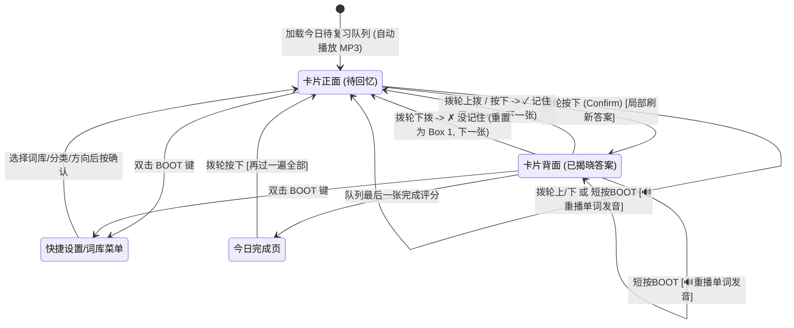

# SPBCN 单词卡 (ePaper 墨水屏版) — 项目移植规划书 (`PLAN.md`)

> **目标项目**：将 SPBCN 词库与发音资源，结合**翻转单词闪卡 + Leitner 5盒间隔复习模式**，移植至 **微雪 ESP32-S3-ePaper-3.97**（480×800 竖屏墨水屏）硬件平台。

---

## 一、 核心设计决策汇总

| 维度 | 选型方案 | 说明 |
| :--- | :--- | :--- |
| **核心玩法** | **翻转闪卡 + Leitner 5盒 SRS**（先不做逐字母拼写） | 卡片正反面翻转复习流，支持 `英→中` 与 `中→英（听音想词）` 双向切换 |
| **屏幕方向** | **竖屏布局 (`480 × 800`)** | 物理屏 800×480 通过软件帧缓冲旋转 90°/270° 映射为 480×800 竖屏，完全对齐手机端卡片上下结构，适合单手握持 |
| **数据与音频存储** | **纯 TF (MicroSD) 卡存储** (`/sdcard/spell/`) | 固件仅含核心驱动与 UI 逻辑（体积小、编译烧录快）；412 个 MP3 发音（5.3MB）、词表 JSON 及学习进度均存放在 TF 卡中 |
| **操控方式** | **三向拨轮 (`GPIO 4/5/6`) + `BOOT` 键 (`GPIO 0`)** | 针对无触控墨水屏深度定制：单击拨轮翻面，上/下拨动评定「记住了 / 没记住」，短按 BOOT 键重播真人 MP3 发音 |

---

## 二、 竖屏 UI 视觉布局规划 (`480 × 800` 单色黑白 + 局部网点纹理)

```text
+--------------------------------------------------+ (0,0)   宽 480px
|  [🐝] SPBCN 单词卡          [R1 单音节]  🔋 86%  |
|  拼字大会 · 小高组 · Round 1 单音节              |  Header (76px)
|  [████████████░░░░░░░░░░░░░░░░░░░░░]             |
|  已掌握 42 / 175                  今日待复习 38  |
+--------------------------------------------------+ (0,76)
| +-------+  +-------+  +-------+  +-------+  +---+|
| | 盒 1  |  | 盒 2  |  | 盒 3  |  | 盒 4  |  |盒5||  Leitner 5盒栏
| |  85   |  |  32   |  |  16   |  |  24   |  |18 ||  (76px)
| |  1天  |  |  2天  |  |  4天  |  |  7天  |  |14d||
| +-------+  +-------+  +-------+  +-------+  +---+|
+--------------------------------------------------+ (0,152)
|                                                  |
|  +--------------------------------------------+  |
|  | [ 元音组合 ]                   R1 · 12/38  |  |
|  |                                            |  |
|  |                 speech                     |  |
|  |                 /spi:tʃ/                   |  |
|  |                   [🔊]                     |  |
|  |                                            |  |  主卡片舞台
|  | - - - - - - - (翻面后展开区) - - - - - - - |  |  Card Stage
|  |                                            |  |  (520px)
|  |               演讲，言语                   |  |  带复古立体硬阴影
|  |   a spoken expression of ideas, opinions   |  |  box-shadow: 5x6px
|  |                                            |  |
|  |   ┃ She has to give a [speech] at the      |  |
|  |   ┃ convention.                            |  |
|  +--------------------------------------------+  |
|                                                  |
+--------------------------------------------------+ (0,672)
|  +--------------------+  +--------------------+  |
|  |  ↓ 拨轮下: 没记住  |  | ↑ 拨轮上/按: 记住了|  |  底部操作区 (94px)
|  +--------------------+  +--------------------+  |
+--------------------------------------------------+ (0,766)
|  BOOT: 🔊读词 ｜ 双击BOOT: 菜单 ｜ 长按BOOT: 全刷|  底栏提示 (34px)
+--------------------------------------------------+ (480,800)
```

### 墨水屏刷新策略（防闪烁 & 低残影）
1. **翻面（正面 → 展示背面答案）**：
   - 采用**单屏上下分栏增量展开**或**卡片框局部刷新 (`EPD_DisplayPart`)**：正面时上半部显示题目（如 `英→中` 显示单词+音标，或 `中→英` 显示中文释义），按下拨轮后直接在卡片下半区局部刷出答案、英文释义与高亮例句（耗时仅 `~300ms`，无黑闪！）。
2. **切换下一张卡片**：
   - 连续局部刷新 **8 张卡片**后，自动触发一次**全局刷新 (`EPD_Display`)** 彻底清除墨水屏残影；也可随时长按 `BOOT` 键手动全局刷新。

---

## 三、 物理按键交互状态机 (Interaction State Machine)



### 按键映射一览表

| 物理按键 | 卡片正面 (未翻面) | 卡片背面 (已翻面) | 快捷设置菜单 (`MenuModal`) |
| :--- | :--- | :--- | :--- |
| **拨轮按下 (`GPIO 5`)** | **翻面揭晓答案** | **✓ 记住了 (Good)** → 下一张 | 确认选中项 / 切换开关 |
| **拨轮上拨 (`GPIO 4`)** | 🔊 正常语速读词 | **✓ 记住了 (Good)** → 下一张 | 光标上移 |
| **拨轮下拨 (`GPIO 6`)** | 🐢 慢速/重播读词 | **✗ 没记住 (Again)** → 下一张 | 光标下移 |
| **BOOT 单击 (`GPIO 0`)** | 🔊 重播发音 | 🔊 重播发音 | 退出菜单返回卡片 |
| **BOOT 双击 (`GPIO 0`)** | 打开快捷设置/词库菜单 | 打开快捷设置/词库菜单 | 退出菜单返回卡片 |
| **BOOT 长按 (`GPIO 0`)** | 强制墨水屏全局全刷 | 强制墨水屏全局全刷 | 强制墨水屏全局全刷 |

---

## 四、 TF 卡目录规范与数据格式 (`/sdcard/spell/`)

所有词表、音频与进度文件均存放在 FAT32 格式的 TF 卡 `/sdcard/spell/` 下，方便通过电脑读卡器直接增删：

```text
/sdcard/spell/
├── decks/
│   ├── manifest.json               # 词库注册表 (spbcn_r1, spbcn_r2, spbcn_r3)
│   ├── spbcn_r1.json               # Round 1 单音节 (175词)
│   ├── spbcn_r2.json               # Round 2 双音节 (130词)
│   └── spbcn_r3.json               # Round 3 多音节 (107词)
├── audio/
│   ├── work.mp3                    # 412 个发音 MP3 文件
│   ├── speech.mp3
│   └── ...
├── fonts/
│   └── u8g2_font_wqy16_gb2312.bin  # 外置或内置中文字库
└── userdata/
    ├── settings.json               # {"deck":"spbcn_r1","cat":"all"}  (音量/方向/自动发音存 NVS)
    ├── progress_spbcn_r1.json      # {"spbcn_r1-0":{"box":2,"due":20746,"seen":true}, ...}
    ├── progress_spbcn_r2.json
    └── progress_spbcn_r3.json
```

---

## 五、 软件模块架构 (`~/projects/esp32-s3-epaper`)

```text
esp32-s3-epaper/
├── platformio.ini                  # PlatformIO 工程配置 (16MB Flash + 8MB PSRAM)
├── AGENTS.md                       # 多 AI 协作开发规范
├── PLAN.md                         # 本项目移植规划书
├── tools/
│   └── prepare_sdcard.py           # 从词表源文件提取词表+音频生成 TF 卡目录
├── include/
│   ├── board_config.h              # 已验证的硬件 GPIO 引脚定义
│   └── spell_types.h               # 卡片、词库、Leitner 进度与状态结构体定义
└── src/
    ├── main.cpp                    # 系统初始化、主事件循环
    ├── bsp/                        # 硬件板级支持包 (Board Support Package)
    │   ├── pmic_axp2101.cpp/h      # AXP2101 电源管理与电池电量读取
    │   ├── epd_3in97.cpp/h         # SSD1677 800x480 墨水屏驱动 (支持全刷/局刷与竖屏旋转)
    │   ├── sdcard_bsp.cpp/h        # SDMMC 4-bit TF卡挂载与文件读写
    │   ├── audio_es8311.cpp/h      # ES8311 I2C/I2S 驱动与 MP3 硬件解码播放
    │   ├── input_buttons.cpp/h     # GPIO 0/4/5/6 拨轮与按键防抖、单击/双击/长按事件队列
    │   └── rtc_pcf85063.cpp/h      # PCF85063 实时时钟读取 (用于 Leitner 到期天数计算)
    ├── core/                       # 核心业务逻辑 (与 UI 解耦)
    │   ├── deck_manager.cpp/h      # 从 /sdcard/spell/decks/ 加载 JSON 词表至 PSRAM
    │   └── leitner_engine.cpp/h    # Leitner 5盒算法、到期队列构建、进度持久化
    └── ui/                         # 480x800 竖屏图形渲染层
        ├── canvas_480x800.cpp/h    # 基于 PSRAM 的 1-bit 竖屏帧缓冲画布 (点/线/圆角框/阴影/中英文字体)
        ├── view_card.cpp/h         # 卡片正反面渲染、进度条、5盒状态栏绘制
        └── view_menu.cpp/h         # 双击 BOOT 呼出的词库/分类/方向设置弹层
```

---

## 六、 分阶段实施路线图 (Phased Roadmap)

### Phase 1：TF 卡数据包构建与基础 BSP 点亮 (Milestone 1)
- [ ] **Step 1.1**：编写并运行 `tools/prepare_sdcard.py`，将词表源文件的 412 个 MP3 与 3 套词表（`spbcn_r1/r2/r3`）自动提取打包到 `sdcard_dist/spell/`。
- [ ] **Step 1.2**：实现 `pmic_axp2101` 与 `sdcard_bsp`（SDMMC 4-bit: `CLK=16, CMD=17, D0=15, D1=7, D2=8, D3=18`），验证挂载 `/sdcard/spell/` 并读取词表 JSON 至 8MB PSRAM。
- [ ] **Step 1.3**：实现 `input_buttons`（拨轮 `GPIO 4/5/6` + `BOOT GPIO 0`），串口验证上拨、下拨、按压、双击、长按事件。

### Phase 2：480×800 竖屏墨水屏引擎与卡片 UI 渲染 (Milestone 2)
- [ ] **Step 2.1**：移植 `epd_3in97`（SSD1677 全刷与局刷驱动）及 `canvas_480x800` 竖屏旋转帧缓冲，集成中英文字体与音标字符渲染。
- [ ] **Step 2.2**：实现卡片视觉风格（方格纸点阵底纹、Leitner 5盒顶栏、分类胶囊标签、硬阴影卡片框、例句高亮）。

### Phase 3：Leitner 间隔复习引擎与 MP3 真人发音 (Milestone 3)
- [ ] **Step 3.1**：实现 `leitner_engine`，完整移植 5 盒晋升/降级逻辑（`[0, 1, 2, 4, 7, 14]` 天）、分类筛选、盒 1~5 专项抽查及 `/sdcard/spell/userdata/` JSON 实时保存。
- [ ] **Step 3.2**：实现 `audio_es8311` + MP3 解码器（`ESP8266Audio` / `libhelix-mp3`），实现切卡自动朗读与按键重播 `/sdcard/spell/audio/{slug}.mp3`。

### Phase 4：快捷菜单、低功耗休眠与打磨 (Milestone 4)
- [ ] **Step 4.1**：实现双击 `BOOT` 键弹出的设置菜单（切换 `R1/R2/R3`、切换 `英→中 / 中→英`、切换分类、调节音量）。
- [ ] **Step 4.2**：接入 `PCF85063` RTC 时间与无操作自动 `EPD_Sleep` / 低功耗待机。
